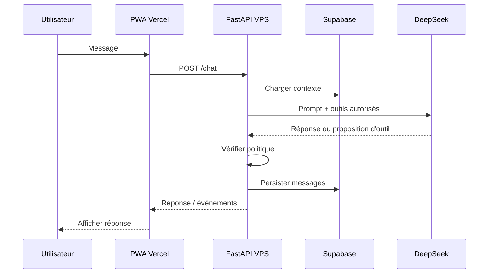
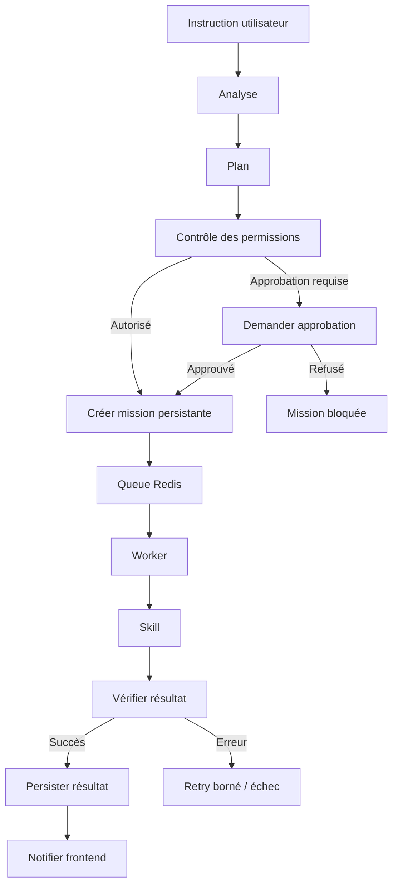

# Architecture système — Kwes

## 1. Vue d'ensemble

Kwes utilise une architecture frontend/backend séparée.

- Frontend : React + TypeScript + Vite, hébergé sur Vercel.
- Backend : FastAPI sur VPS.
- Workers : processus persistants sur VPS.
- Données : Supabase PostgreSQL, Storage et pgvector.
- Cache/queue : Redis.
- Intelligence : DeepSeek via adaptateur.
- Voix : ElevenLabs Speech Engine via adaptateur.

## 2. Responsabilités

### Frontend
- rendu UI ;
- session utilisateur ;
- saisie texte ;
- autorisation microphone ;
- streaming ;
- affichage des tâches ;
- préférences.

Le frontend ne contient aucune clé fournisseur secrète et ne décide pas des autorisations.

### API Backend
- authentification et autorisation ;
- validation des entrées ;
- gestion des conversations ;
- orchestration ;
- politiques de sécurité ;
- création des tâches ;
- accès aux données.

### Agent Core
- analyse d'intention ;
- génération de plan ;
- sélection d'outils ;
- coordination des étapes ;
- synthèse finale.

### Workers
- exécution des tâches longues ;
- retries bornés ;
- heartbeat ;
- persistance des résultats ;
- reprise après redémarrage.

### Data Layer
- utilisateurs ;
- conversations ;
- messages ;
- missions ;
- exécutions ;
- mémoire ;
- audit.

## 3. Flux de conversation

## 4. Flux de mission asynchrone

## 5. Communication réseau

- HTTPS obligatoire.
- WebSocket sécurisé (`wss`) pour les événements temps réel.
- CORS limité aux domaines frontend.
- Authentification sur chaque endpoint.
- Validation d'origine WebSocket.
- Rate limiting par utilisateur et route.
- Timeouts explicites.

## 6. Déploiement

Vercel ne doit pas héberger les workers persistants. Les tâches longues, Playwright, Redis et les connexions temps réel de longue durée restent sur le VPS.

## 7. Résilience

- tâches persistées avant exécution ;
- heartbeat worker ;
- leases ou verrous temporaires ;
- retries avec backoff exponentiel et jitter ;
- dead-letter queue pour les tâches épuisées ;
- idempotence des opérations externes ;
- health checks ;
- circuit breaker pour fournisseurs instables.

## 8. Évolution

Commencer par un monolithe modulaire. Extraire un service indépendant uniquement lorsqu'une contrainte de charge, d'isolation ou de déploiement le justifie.
