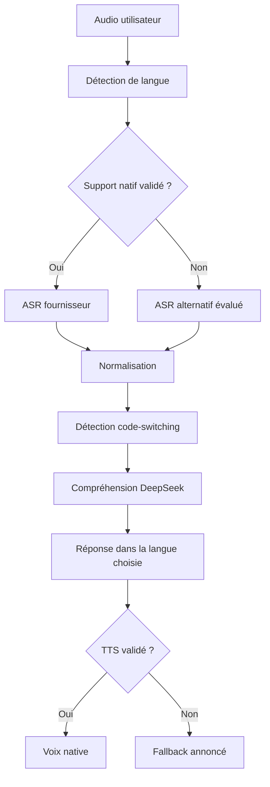

# Language Intelligence — Kwes

## 1. Objectif

Permettre à Kwes de comprendre et de répondre dans plusieurs langues, avec une priorité aux langues populaires d'Afrique de l'Ouest et à la réalité du mélange de langues dans une conversation.

## 2. Langues prioritaires à évaluer

La liste est une cible de recherche et de validation, pas une garantie de support fournisseur.

| Pays | Langues candidates |
|---|---|
| Bénin | Fon, Yoruba, Bariba, Dendi, Mina |
| Ghana | Akan/Twi, Ewe, Ga, Dagbani |
| Côte d'Ivoire | Dioula, Baoulé, Bété, Sénoufo, Nouchi |
| Guinée | Pular, Maninka, Susu, Kissi |
| Burkina Faso | Mooré, Dioula, Fulfuldé, Gourmanchéma |
| Mali | Bambara, Fulfuldé, Soninké, Songhaï, Tamasheq |

Français et anglais constituent les langues de lancement prioritaires.

## 3. Pipeline

## 4. Niveaux de support

- **Natif validé :** reconnaissance et synthèse testées avec des locuteurs natifs.
- **Reconnaissance expérimentale :** transcription possible, qualité non garantie.
- **Compréhension assistée :** transcription/normalisation via un moteur complémentaire.
- **Fallback :** réponse dans une langue de repli explicitement annoncée.

Ne jamais afficher « langue supportée » uniquement parce qu'un modèle accepte un code de langue.

## 5. Évaluation

Pour chaque langue :
- au moins plusieurs locuteurs ;
- accents et variantes ;
- environnement calme et bruité ;
- phrases courtes et longues ;
- code-switching ;
- noms propres et termes métiers ;
- mesure WER/CER lorsque la transcription de référence est disponible ;
- évaluation de naturel TTS par locuteurs natifs ;
- test de compréhension de l'intention.

## 6. Corpus

Le corpus doit être collecté avec consentement explicite, droits d'utilisation documentés et possibilité de retrait. Ne pas aspirer des enregistrements privés ou des contenus sans autorisation.

## 7. UX de langue

- mode automatique ;
- sélection manuelle ;
- préférence par conversation ;
- commande « parle-moi en… » ;
- affichage du niveau de confiance lorsque disponible ;
- demande de clarification si le sens est incertain.

## 8. Priorisation

Phase 1 : français et anglais fiables.  
Phase 2 : langues africaines dont ASR et TTS sont vérifiés.  
Phase 3 : adaptateurs spécialisés, corpus consentis et modèles évalués.  
Phase 4 : code-switching et variantes régionales avancés.
