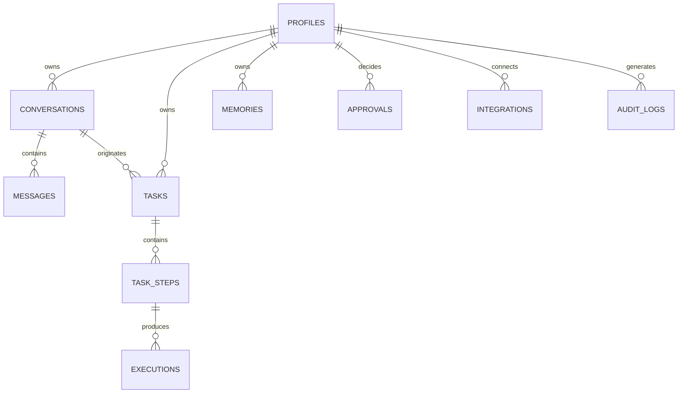

# Modèle de données — Kwes

## 1. Principes

- PostgreSQL comme source de vérité.
- UUID pour les identifiants.
- `user_id` sur toutes les données privées.
- Horodatages UTC.
- RLS activé pour les tables accessibles via Supabase client.
- Backend privilégié uniquement pour les opérations serveur.
- Secrets hors des tables applicatives ordinaires.

## 2. Tables principales

### profiles
`id`, `display_name`, `locale`, `timezone`, `created_at`, `updated_at`.

### conversations
`id`, `user_id`, `title`, `status`, `language`, `created_at`, `updated_at`.

### messages
`id`, `conversation_id`, `user_id`, `role`, `content`, `content_type`, `metadata`, `created_at`.

### tasks
`id`, `user_id`, `conversation_id`, `title`, `goal`, `status`, `priority`, `progress`, `created_at`, `updated_at`, `started_at`, `completed_at`, `result_summary`, `error_code`.

### task_steps
`id`, `task_id`, `step_key`, `title`, `skill_id`, `status`, `input_json`, `output_json`, `depends_on`, `attempt_count`, `created_at`, `updated_at`.

### executions
`id`, `task_id`, `step_id`, `tool_name`, `status`, `input_redacted`, `output_summary`, `started_at`, `finished_at`, `duration_ms`, `error_code`, `idempotency_key`.

### skills
`id`, `name`, `description`, `current_version`, `enabled`, `created_at`.

### skill_versions
`id`, `skill_id`, `version`, `manifest_json`, `artifact_hash`, `status`, `created_at`, `approved_at`.

### memories
`id`, `user_id`, `category`, `content`, `source_type`, `source_id`, `confidence`, `sensitivity`, `expires_at`, `created_at`, `updated_at`.

### approvals
`id`, `user_id`, `task_id`, `action_type`, `payload_hash`, `summary`, `status`, `expires_at`, `decided_at`.

### integrations
`id`, `user_id`, `provider`, `status`, `scopes`, `secret_reference`, `created_at`, `updated_at`.

### audit_logs
`id`, `user_id`, `actor_type`, `actor_id`, `action`, `resource_type`, `resource_id`, `decision`, `metadata_redacted`, `created_at`.

### notifications
`id`, `user_id`, `type`, `title`, `body`, `read_at`, `resource_type`, `resource_id`, `created_at`.

## 3. Relations

## 4. Statuts

Task :
- `queued`
- `planning`
- `awaiting_approval`
- `running`
- `paused`
- `completed`
- `failed`
- `cancelled`

Step :
- `pending`
- `ready`
- `running`
- `awaiting_approval`
- `completed`
- `failed`
- `skipped`
- `cancelled`

## 5. Indexes

Prévoir des index sur :
- `user_id`;
- `conversation_id`;
- `task_id`;
- `status`;
- `created_at`;
- `idempotency_key` unique lorsque applicable ;
- vecteurs selon la configuration pgvector.

## 6. Rétention

Définir une politique explicite pour :
- logs techniques ;
- audit ;
- conversations ;
- transcriptions ;
- fichiers ;
- embeddings.

Les durées seront configurables et communiquées à l'utilisateur. Les données de sécurité nécessaires à l'audit peuvent avoir une rétention distincte.
